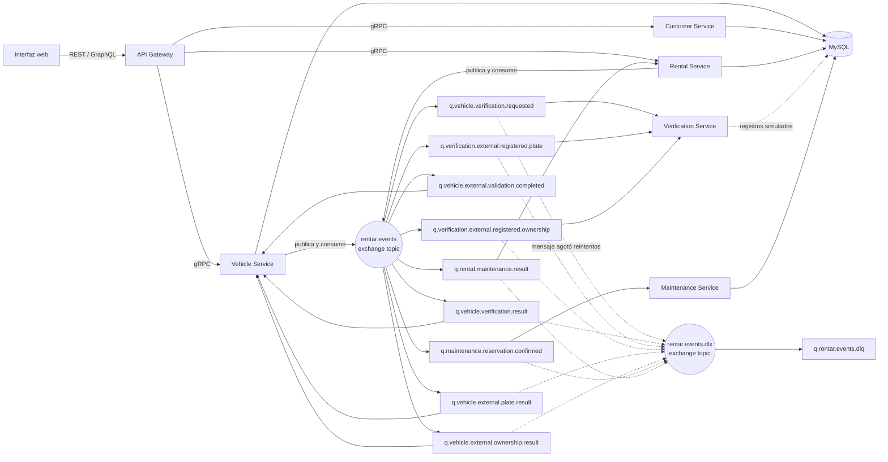

# Arquitectura de Rentar - Hito 3

## Decisión del broker

Se elige **RabbitMQ** para los eventos de Rentar.

| Criterio | RabbitMQ | Apache Kafka |
| --- | --- | --- |
| Encaje con el TP | Exchanges topic, routing keys y colas permiten expresar los flujos del enunciado directamente. | Los topics y consumer groups también resuelven los flujos, con un modelo de registro distribuido. |
| Operación local | La imagen `rabbitmq:3.13-management` incluye consola web y se integra en el Compose actual. | Requiere operar el broker y, según el modo de despliegue, configurar KRaft o ZooKeeper; no aporta una necesidad del alcance actual. |
| Distribución | Una cola durable por consumidor permite que verificaciones independientes reciban el mismo evento y avancen por separado. | Los grupos de consumidores distribuyen particiones y escalan bien el procesamiento de streams. |
| Complejidad para este sistema | Baja para los ocho consumidores previstos; bindings y dead-letter exchange cubren el ruteo y los fallos. | Más conceptos operativos y de particionado que los necesarios para estos flujos de trabajo. |

Kafka sería preferible si Rentar necesitara retención y reproducción de grandes volúmenes de eventos, procesamiento de streams o escalado por particiones. Esos requisitos no forman parte de este hito. La consola RabbitMQ queda disponible en `http://localhost:15672`; las credenciales se configuran mediante `RABBITMQ_USER` y `RABBITMQ_PASSWORD`.

## Diagrama

El diagrama muestra la arquitectura objetivo del Hito 3. Las cajas de Verification Service y Maintenance Service representan servicios nuevos que se implementarán en las tareas posteriores.

## Topología

- `rentar.events`: exchange durable de tipo `topic` para los eventos del dominio.
- Nueve colas de negocio durables, una por consumidor. Las dos verificaciones de vehículos externos tienen colas distintas, aunque reciben `vehiculos.externos.registrados`, para ejecutarse de forma independiente. Vehicle Service también consume el evento `vehiculos.externos.validacion.completada` para finalizar la incorporación de manera asíncrona.
- `rentar.events.dlx`: exchange durable de tipo `topic` para mensajes que un consumidor no puede procesar después de sus reintentos.
- `q.rentar.events.dlq`: cola durable única de mensajes fallidos, enlazada con la routing key `dead`. Los encabezados `x-death` conservan la cola/routing key original para investigar el fallo.
- La topología se declara de manera idempotente al iniciar Compose mediante `rabbitmq-topology-init`. No depende de qué servicio consumidor arranque primero.

La topología comprende **nueve colas de negocio más una DLQ**. Los eventos se publican con mensajes persistentes y los productores deben usar publisher confirms. RabbitMQ confirma recepción del mensaje publicado; para garantizar atomicidad entre una escritura de base de datos y la publicación se deberá agregar el patrón outbox si ese requisito se incorpora al alcance.
